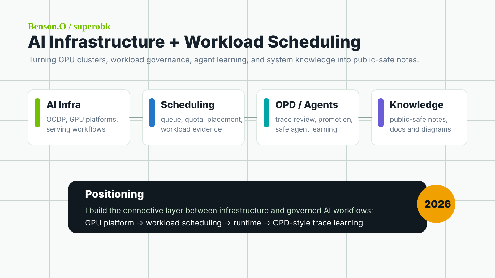

<p align="center">
  
</p>

# Benson.O

**AI Infrastructure / Workload Scheduling / Agent Learning**

I am an AI product and solution architect working on the practical layer between GPU infrastructure and intelligent applications. My work focuses on turning GPU clusters, workload scheduling, model deployment, safe agent execution, and engineering knowledge into reusable platforms and public-safe technical notes.

My current public focus is on **Kubernetes-native AI workloads**, **GPU scheduling boundaries**, **model-serving workflows**, and **OPD-inspired agent learning systems**. I care about making the boundary clear: the platform admits and governs workloads, the scheduler places resources, the runtime executes distributed training or serving, and the product layer makes the workflow understandable and repeatable.

More details can be found on [GitHub](https://github.com/superobk/) and [LinkedIn](https://www.linkedin.com/in/bensonou/).

<p align="center">
  
</p>

---

# Focus

## Workload Scheduling And GPU AI Infrastructure

- Kubernetes-native workload admission, queueing, quota, and placement.
- GPU visibility, device enablement, resource isolation, and operational boundaries.
- Developer workspaces and model-serving templates for private AI platforms.
- Clear separation between platform orchestration, scheduling, and distributed runtime execution.

## Model Runtime And Developer Workflows

- Practical serving paths around vLLM, TensorRT-LLM, Triton, and related runtime layers.
- Browser-based development environments such as code-server and notebook-style workspaces.
- Public-safe troubleshooting notes for GPU visibility, workload startup, endpoint exposure, and runtime logs.

## OPD And Agent Learning

- OPD-inspired trajectory learning for personal-agent and operational-agent workflows.
- Human-reviewed promotion gates before turning traces into reusable behavior.
- Supervision and execution boundaries for safe agent improvement.
- Evaluation-first thinking: learning from work traces without exposing private data or internal implementation details.

## Knowledge Systems

- Turning project work into reusable diagrams, notes, and implementation checklists.
- Separating raw exploration, internal delivery material, and public technical summaries.
- Keeping public pages concise while preserving deeper private research context elsewhere.

---

# Selected Work

## OCDP: One Click Model Deployment

OCDP is an AI infrastructure direction for turning heterogeneous GPU clusters into repeatable model deployment workflows. The public-facing idea is simple: make GPU development environments, model-serving endpoints, workload templates, and platform governance available through a browser-based control surface instead of asking users to operate Kubernetes and GPU nodes directly.

Public-safe keywords: Kubernetes, workload scheduling, GPU quota, workspace isolation, model-serving templates, vLLM, TensorRT-LLM, Triton, code-server, operational visibility.

## Workload Scheduling Notes

This direction explores how AI workloads should be admitted, placed, observed, and debugged across shared GPU clusters. The emphasis is on architectural boundaries rather than private implementation: queue admission, quota, gang-style resource readiness, runtime ownership, and repeatable evidence for training or serving jobs.

Public-safe keywords: Kueue-style admission, Kubernetes jobs, GPU scheduling, Ray or Kubeflow-style execution, NCCL/runtime boundary, logs, checkpoints, workload status.

## OPD / Personal Agent Learning

This direction studies how agent work traces can become safer reusable behavior. The public framing is intentionally high level: collect traces, evaluate them, separate supervision from execution, promote only reviewed patterns, and avoid treating unverified automation as production autonomy.

Public-safe keywords: OPD, trajectory learning, agent memory, skill reuse, audit trail, human review, promotion gate, evaluation loop.

---

# Public Boundary

This homepage intentionally hides sensitive project details. It does not publish customer names, internal repository paths, private datasets, application campaign material, unpublished research progress, or exact deployment configuration.

The useful public layer is the engineering shape:

- what problem the system addresses
- which boundary matters
- how a developer should reason about the workflow
- what evidence should be captured before making stronger claims

---

# Technical Map

```text
GPU Cluster
  -> Kubernetes / GPU Enablement
  -> Workload Queue / Quota / Placement
  -> Runtime / Training / Serving
  -> Platform Control Surface / Template / Logs / Permissions
  -> Agent Trace / OPD Learning / Human Review
  -> Public-Safe Notes / Reusable Engineering Knowledge
```

---

# Experience Narrative

My work sits across product architecture, solution delivery, and research-oriented prototyping. I translate internal engineering capability into reusable product stories, deployment workflows, teaching material, and public technical content.

I prefer systems that make boundaries explicit:

- platform versus runtime
- scheduling versus distributed execution
- workload admission versus workload progress
- agent learning versus agent autonomy
- public evidence versus private implementation

This boundary-first style makes technical material easier to debug, teach, and reuse.

---

# Links

- GitHub: [github.com/superobk](https://github.com/superobk/)
- LinkedIn: [linkedin.com/in/bensonou](https://www.linkedin.com/in/bensonou/)

---

# Life

I like building personal knowledge systems around real engineering work: raw materials, reusable notes, diagrams, demos, and public artifacts. The goal is not just to remember projects, but to make each project easier to explain, verify, and continue.
