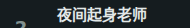
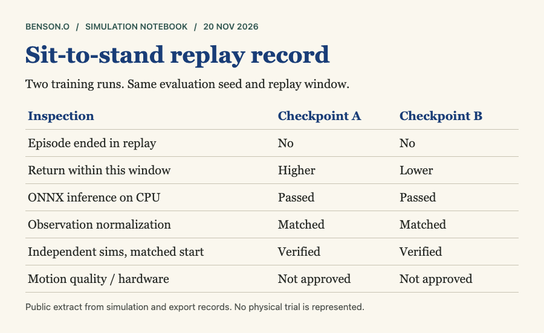

*Field note · 20 November 2026 · Simulation only*

A small biped can earn a reward without learning the movement I had in mind. It can also move correctly in the training environment and behave differently after export. I use three separate checks to tell those problems apart.

[Training](#training) · [Checkpoint replay](#replay) · [ONNX verification](#export)

## 01 / Train a sit-to-stand policy
{: #training}

The task starts with a seated robot in simulation. At each step, a policy reads an observation and chooses joint actions; the simulator advances the body and returns a reward. Training updates the policy. Saving a checkpoint freezes one version so I can inspect what it actually does without continuing to update it.

*An earlier training-console screenshot, cropped to the standing-up task label. It shows how a task is queued, not the outcome of either run below.*

## 02 / Replay two checkpoints under the same conditions
{: #replay}

I took one checkpoint from each of **two independent training runs**. These are not earlier and later versions of a single policy. For replay, I kept the task, evaluation seed and observation window the same and recorded returns, peak action magnitude and whether an episode ended.

Both replays reached the end of that window without an episode ending. The first checkpoint earned a higher cumulative reward and used a smaller peak action. That makes it worth inspecting, not a winner: neither observation tells me by itself whether the robot stood up cleanly or would recover from a different start.

*Screenshot of a public summary derived from the two replay and export records. It is not a frame of the robot in motion.*

## 03 / Does ONNX still run the same policy?
{: #export}

**First, hold the inputs fixed.** I passed identical raw observations to each training model and its corresponding ONNX export. Comparing actions here checks the policy together with observation normalization; a mismatch at this point is not a physics problem. Both self-contained exports ran on CPU, and their actions agreed closely on the recorded samples.

**Then, let the simulations diverge.** For each checkpoint I started two independent simulation environments in the same verified state. The training model controlled one, and the exported model controlled the other. Joint positions stayed close over the short comparison. This catches differences that an isolated input/output check can miss, without claiming long-horizon equivalence.

**What remains open:** simulation motion quality and physical-robot acceptance. A longer replay across several starts, with posture and recovery inspected, is a separate test. Neither successful conversion nor a non-terminating episode substitutes for it.
